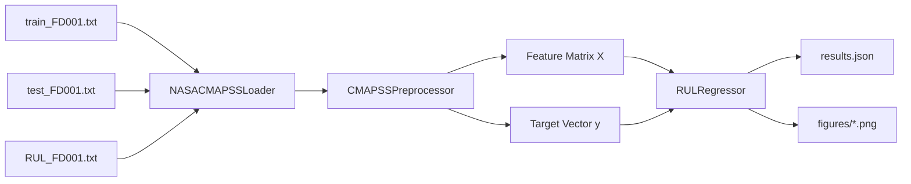

# Architecture Document

## Design Principles

1. **Modularity**: Each concern (data, model, eval, viz) is a separate package
2. **Testability**: Every module has pytest coverage with synthetic fixtures
3. **Reproducibility**: `Makefile` + `pyproject.toml` pin all dependencies
4. **Observability**: Pipeline saves `results.json` with all metrics and metadata

## Data Flow

## Package Responsibilities

| Package | Responsibility | Key Classes |
|---------|---------------|-------------|
| `data.loader` | Download + load raw NASA files | `NASACMAPSSLoader` |
| `data.preprocessor` | Feature engineering + scaling | `CMAPSSPreprocessor` |
| `models.anomaly_detector` | Unsupervised anomaly detection | `AnomalyDetector` |
| `models.rul_regressor` | RUL regression ensemble | `RULRegressor` |
| `models.survival_model` | Survival analysis (Cox/KM/Weibull) | `SurvivalModel` |
| `evaluation.metrics` | c-index, MAE, RMSE, R² | `c_index`, `forecast_metrics` |
| `pipeline.orchestrator` | End-to-end execution | `CMAPSSPipeline` |
| `visualization.plots` | Static matplotlib figures | `save_sensor_degradation_plot` |
| `visualization.dashboard` | Interactive Streamlit app | `run_dashboard` |

## Testing Strategy

- **Unit tests**: Each class in isolation with synthetic fixtures
- **Integration tests**: Pipeline schema validation
- **CI**: GitHub Actions runs on Python 3.9, 3.10, 3.11
- **Notebook check**: CI verifies notebook executes without errors

## Deployment

- **GitHub Pages**: Static project detail page at `docs/index.html`
- **Streamlit**: Local dashboard via `make dashboard`
- **Docker**: `make docker-build && make docker-run`
